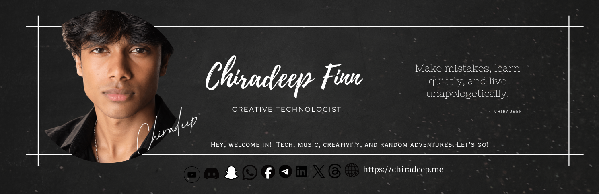

<h1>Hey👋 Welcome!!!</h1>

  

 

 

  

<h2><code>01.</code> &nbsp; WHO AM I?</h2>

I'm a student developer interested in what happens when technology meets creative expression.

Some days, I'm building software or experimenting with AI. Other days, I'm producing music, writing, researching, or exploring photography. I'm interested in the connections between these disciplines — and in turning the ideas that emerge into real things.

<table>
  <tr>
    <td width="50%" valign="top">
      <h3>Technical_interests:</h3>
      <ul>
        <li>Artificial intelligence & machine learning</li>
        <li>Software and web development</li>
        <li>Creative technology</li>
        <li>Data analysis and research</li>
      </ul>
    </td>
    <td width="50%" valign="top">
      <h3>Creative_interests:</h3>
      <ul>
        <li>Music production and sound</li>
        <li>Photography and visual storytelling</li>
        <li>Creative writing</li>
        <li>Visual art and experimentation</li>
      </ul>
    </td>
  </tr>
</table>

**Website:** <a href="https://chiradeep.me">chiradeep.me</a>

  

<h2><code>02.</code> &nbsp; TECH STACK</h2>

**SOFTWARE_ENGINEERING**

**AI_AND_DATA**

**DEVELOPMENT_ENVIRONMENT**

**CREATIVE_ENVIRONMENT**

Technology icons represent tools used or explored. Individual libraries and frameworks are not necessarily used in every project.

  

<h2><code>03.</code> &nbsp; RESEARCH & WRITING</h2>

I'm interested in investigating how machine learning understands music and how AI influences human creativity.

**AI-Assisted Creativity:**

*Beyond the Prompt: Measuring the Effects of AI-Assisted Ideation on Human Creative Originality and Ownership.*

Investigating the relationship between AI-assisted ideation, creative originality, and human ownership.

These research directions are at different stages of development. I'll share methodology, experiments, findings, and reproducible materials as the work progresses.

  

<h2><code>04.</code> &nbsp; BEYOND THE TERMINAL</h2>

I don't see software, music, writing, and visual art as completely separate worlds.

I'm interested in what they can teach each other — and what becomes possible when they overlap.

<code>sound + code + ideas + images = something unexpected</code>

<h2><code>05.</code> &nbsp; GITHUB ANALYTICS</h2>

  

<h2><code>06.</code> &nbsp; FIND ME ONLINE</h2>

  
Thanks for stopping by. Have a good one✌.
  

